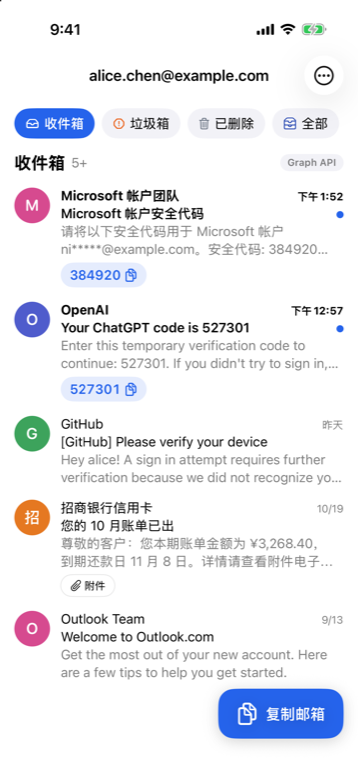
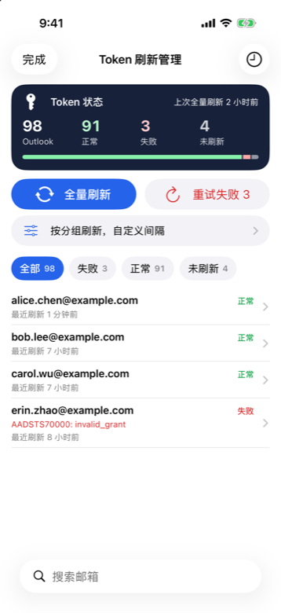

# MailHub

[outlookEmail](https://github.com/assast/outlookEmail) 的 iOS 原生客户端。

outlookEmail 是一个自建的多邮箱管理服务(Outlook/Hotmail OAuth、Graph API、IMAP)。MailHub 不直接连邮箱，而是登录你自己部署的 outlookEmail 服务器，用它的完整管理 API 在手机上收信、管理账号。**使用前需要先部署好 outlookEmail 服务端。**

<p>





</p>

> 截图为演示数据。

## 功能

- **收信**：收件箱 / 垃圾箱 / 已删除 / 全部，邮件详情、附件预览与 ZIP 打包下载、标记已读、删除
- **验证码**：自动识别邮件里的验证码，列表上一键复制
- **账号管理**：分组(三级)与标签筛选、搜索、导入(Outlook / Gmail / QQ / 163 / 自定义 IMAP 等)、编辑(备注、分组、标签、别名、代理、转发)、批量操作、导出
- **Token 刷新管理**：全量刷新与重试失败(实时进度)、按分组或选中账号刷新并自定义间隔、刷新记录
- **邮箱分享**：生成限时 / 永久分享链接，可限制只看最新 N 封，二维码，撤销与管理
- **临时邮箱**：GPTMail / DuckMail / Cloudflare Temp Email
- **写邮件 / 回复**：Outlook 账号通过 Graph 发送纯文本邮件
- **OAuth 助手**：App 内完成微软授权，拿到 Refresh Token 直接导入账号
- **转发记录**

## 隐私与安全

- **不保存登录密码**：用密码登录换取服务器的会话 Cookie(永久会话，直到退出或服务端改密码)
- **默认阻止远程图片**：邮件里的远程图片、样式、字体通过 CSP 拦截，防追踪像素；可单次显示或信任发件人
- **邮件正文不执行脚本**，邮件内跳转被拦截；点链接先显示真实地址
- 可选 **Face ID 解锁**；离开 App 时遮挡内容
- 复制的验证码 / 邮箱 **1 分钟后自动从剪贴板清除**，且不同步到其他设备
- 账号凭据需 Face ID 验证后才显示
- 网络响应不写入磁盘缓存；导出文件用完即删
- 连接服务器 **只允许 https**，局域网地址(IP、`.local`)除外

## 构建

需要 Xcode 26 或更新版本，iOS 18+。

```sh
git clone <本仓库>
open MailHub.xcodeproj
```

在 Xcode 里选择自己的开发团队和 Bundle ID 后运行即可。项目没有第三方依赖。

`tools/make-icon.swift` 用于生成 App 图标：

```sh
swift tools/make-icon.swift icon.png 1024
```

Debug 构建带一个演示数据模式(Release 不包含)，用于截图：启动参数 `-MailHubDemo YES -MailHubDemoScreen home`，可选页面见 `MailHub/Demo/DemoMode.swift`。

## 声明

本项目与 outlookEmail 作者、Microsoft 均无关联。Outlook、Hotmail 是 Microsoft 的商标。

## 许可证

[MIT](LICENSE)
