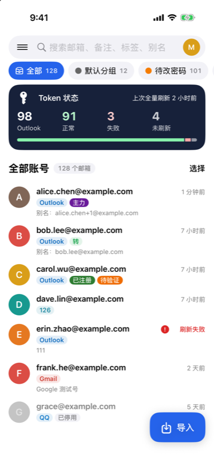
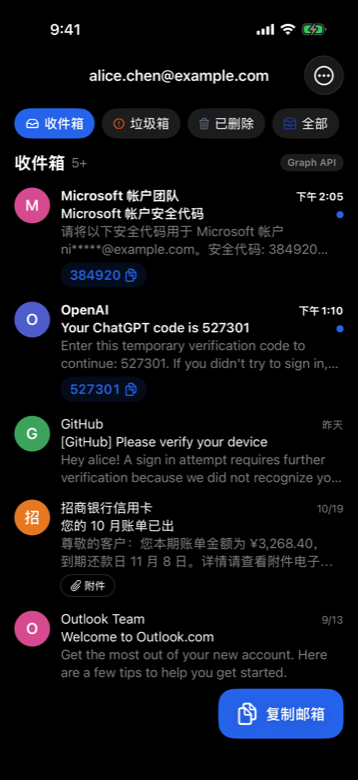
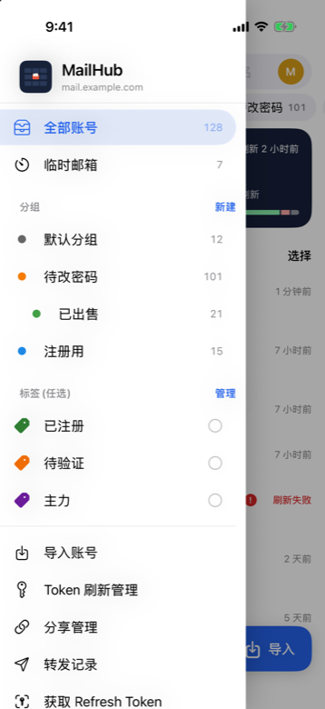
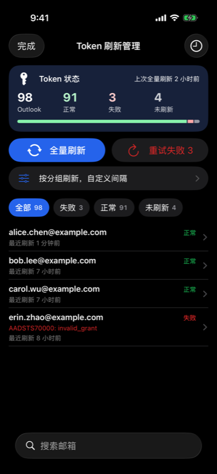

# MailHub

[outlookEmail](https://github.com/assast/outlookEmail) 的 iPhone 客户端：收信、复制验证码、管理账号、刷新 Token

> [!IMPORTANT]
> MailHub 只是客户端，需要先自己部署 outlookEmail 服务端。App 登录你的服务器，用的是和网页版同一套接口；账号和 Token 存在服务器上，App 只保存登录会话。

## 下载与安装

1. 到 [Releases](https://github.com/eddielee214/MailHub/releases) 下载 `.ipa`。
2. ipa 没有签名，要用你自己的 Apple ID 或证书签名后安装，例如：
   - [Sideloadly](https://sideloadly.io/)：电脑连上 iPhone，拖入 ipa，填 Apple ID。免费 Apple ID 签的 App 7 天后要重签
   - [AltStore](https://altstore.io/)
   - 有开发者证书的话，用自己的证书和描述文件重签
3. 打开 App，填服务器地址和网页登录密码。

## 功能

**收信**

- 收件箱 / 垃圾箱 / 已删除 / 全部，邮件详情、附件预览、全部附件打包下载
- 识别邮件里的验证码，在列表上直接复制
- 标记已读、删除；Outlook 账号可以写邮件和回复(Graph 纯文本)

**账号管理**

- 三级分组、标签筛选、搜索；按分组导入 Outlook / Gmail / QQ / 163 / 自定义 IMAP 等账号
- 编辑备注、分组、标签、别名、代理、转发开关；批量移动、打标签、启停、删除、导出
- 在 App 里完成微软 OAuth 授权，拿到 Refresh Token 直接导入

**Token 刷新**

- 全量刷新、重试失败，显示每个账号的结果
- 按分组或选中的账号刷新，可以设置账号之间间隔几秒
- 刷新记录和失败原因

**其他**

- 邮箱分享：限时或永久链接、只给看最新 N 封、二维码，可撤销
- 临时邮箱：GPTMail / DuckMail / Cloudflare Temp Email
- 转发记录、立即检查转发

## 隐私与安全

- 不保存登录密码，只保留服务器的登录会话
- 默认不加载邮件里的远程图片、样式和字体，发件人没法用追踪像素知道你打开了邮件；可以单次显示，或信任某个发件人
- 邮件正文不执行脚本；点链接先显示真实地址
- 可以开 Face ID 解锁；切到后台时遮住内容；看账号凭据要先过 Face ID
- 复制的验证码和邮箱 1 分钟后从剪贴板清除，也不同步到其他设备
- 公网服务器只允许 https，局域网地址才能用 http；网络响应不写入磁盘缓存

## 自己编译

需要装了 Xcode 26 或更新版本的 Mac。用 Xcode 打开 `MailHub.xcodeproj`，在 Signing 里选你自己的开发团队和 Bundle ID，然后运行。没有第三方依赖。

图标和演示模式

- App 图标由 `tools/make-icon.swift` 生成：`swift tools/make-icon.swift icon.png 1024`
- Debug 版带演示数据模式(Release 不包含)，用于截图：启动参数 `-MailHubDemo YES -MailHubDemoScreen home`，可选页面见 `MailHub/Demo/DemoMode.swift`

## 说明

- 服务端是 [assast/outlookEmail](https://github.com/assast/outlookEmail)，MailHub 的功能都靠它的 API。
- 这是我个人维护的项目，和 outlookEmail 作者、Microsoft 都没有关系，有问题请在[本仓库](https://github.com/eddielee214/MailHub/issues)提。Outlook、Hotmail 是 Microsoft 的商标。
- 仓库里没有任何服务器地址、Cookie 或凭据，截图用的是演示数据。

[MIT](LICENSE) 许可。
